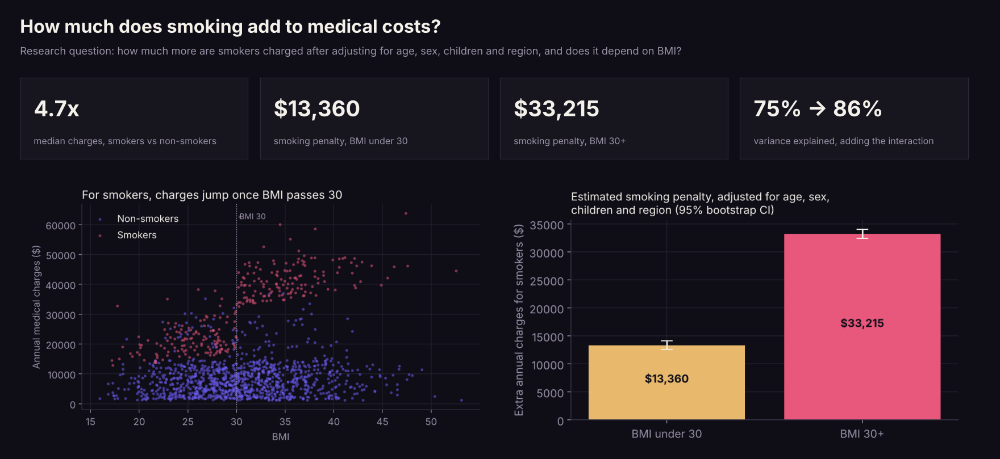
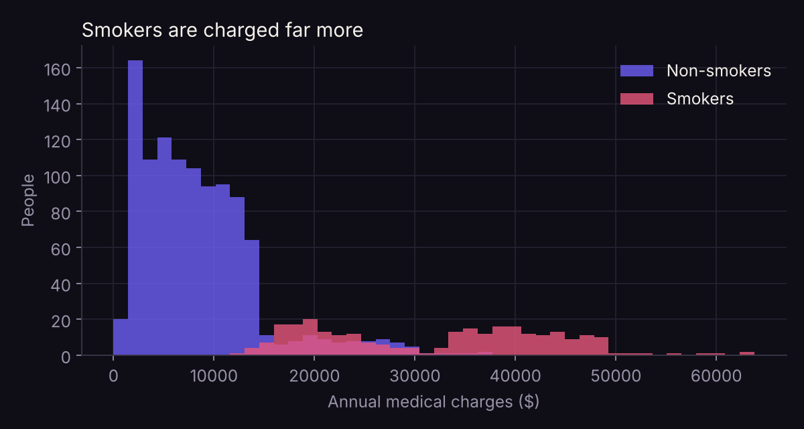
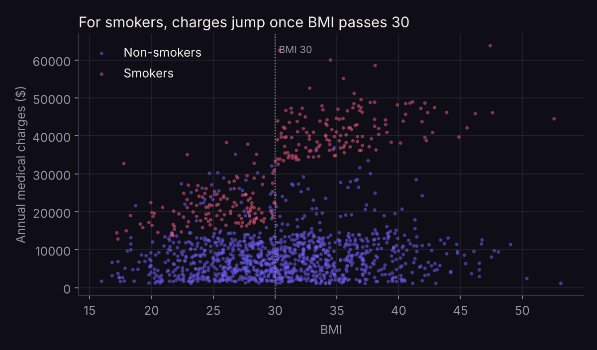
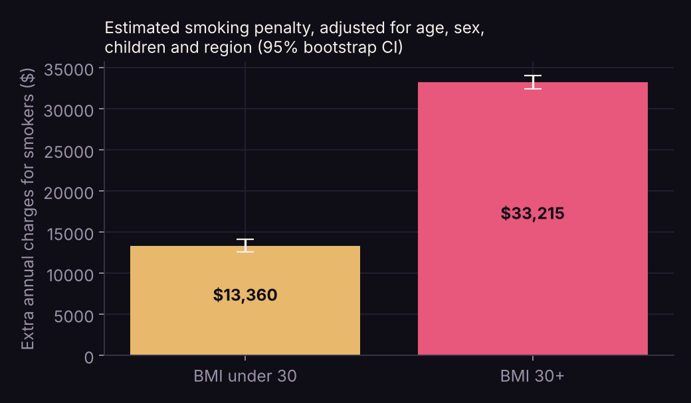

# How much does smoking add to medical costs, and does it depend on BMI?



*Summary dashboard, generated by the notebook from the results.*


## Research question

In a dataset of 1,338 insured adults, how much higher are smokers' annual medical charges once age, sex, BMI, children and region are accounted for? And is the smoking penalty the same for everyone, or does it depend on body weight?

## Data

[Medical Cost Personal Datasets](https://www.kaggle.com/datasets/mirichoi0218/insurance) on Kaggle, originally from *Machine Learning with R* by Brett Lantz. The book describes it as **simulated** from US Census demographics, so the findings describe patterns in this data rather than real-world causal effects. `insurance.csv` is included here; one exact duplicate row was removed, leaving 1,337 people.

## Method

- Raw comparison of smokers and non-smokers (Mann–Whitney U test).
- Linear regression of annual charges on age, sex, BMI, children, region and smoking.
- A second model adding a **smoking × BMI 30+** interaction, to test whether the smoking penalty depends on weight.
- 2,000 bootstrap resamples to check the confidence intervals.

## Findings



1. **Smokers are charged about 4.7 times as much.** The median is $34,456 for smokers against $7,346 for non-smokers (p < 0.001).
2. **The smoking penalty more than doubles above BMI 30.** After adjusting for age, sex, children and region:
   - BMI under 30: smokers pay **$13,360** more (95% bootstrap CI $12,600–$14,132).
   - BMI 30+: smokers pay **$33,215** more (95% CI $32,453–$34,040).
3. **BMI 30+ makes almost no difference for non-smokers** (+$204, p = 0.47). The weight effect only appears together with smoking.
4. **Adding the interaction substantially improves the model.** It explains 86% of the variation in charges, compared with 75% without it. Each extra year of age adds about $265.





The lesson: an average "smoking costs $23,847 more" (the simple additive model) hides two very different groups. A pricing or health-outreach model that ignores the interaction would undercharge one and overcharge the other.

## Methods and what I learnt

| Method | What it taught me |
|---|---|
| **Interaction terms in regression** | An "average" smoking effect of $23,847 hid two very different groups. Letting the effect depend on BMI revealed $13,360 vs $33,215. |
| **Comparing models by explained variance** | Adding one interaction lifted R² from 75% to 86%, a concrete way to judge whether extra complexity earns its place. |
| **Bootstrap confidence intervals** | Resampling 2,000 times gave intervals that don't rely on the regression's assumptions, a useful check on the standard errors. |
| **Non-parametric testing** | Charges are skewed, so the Mann–Whitney U test was more appropriate than a t-test for the raw comparison. |
| **Being upfront about data origin** | Checking where the dataset came from (a textbook simulation) changed the conclusion from "smoking causes" to "in this data". |

## Limitations

- **Simulated data**, so real-world effects can't be inferred.
- **Charges are not health.** They reflect pricing as well as illness.
- **BMI 30 is a simple cut-off**, and BMI is only a rough measure of body fat.
- **Missing factors** such as medical history, income and insurance plan.

## Run it

```bash
pip install pandas numpy scipy statsmodels matplotlib jupyter
jupyter notebook smoking_medical_costs.ipynb
```

Python · pandas · statsmodels · SciPy · Matplotlib

---

**Suwaasha Murugaperumal** · [Portfolio](https://suwaasham.github.io) · [LinkedIn](https://www.linkedin.com/in/suwaasham/) · [GitHub](https://github.com/SuwaashaM)
